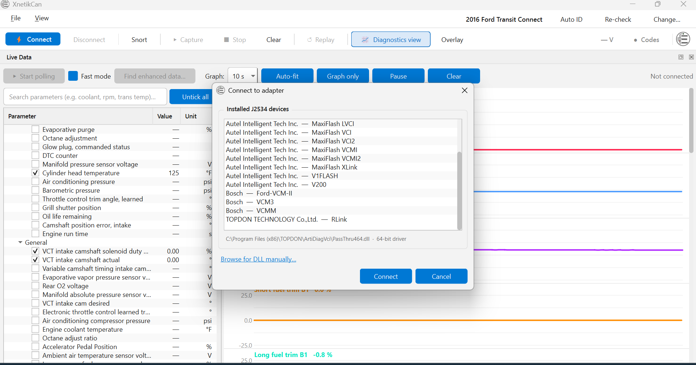
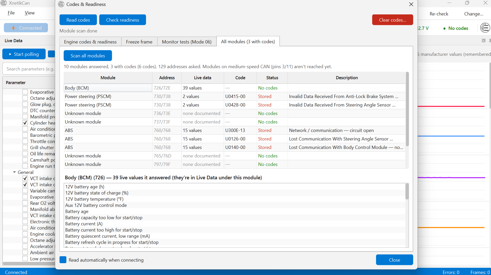
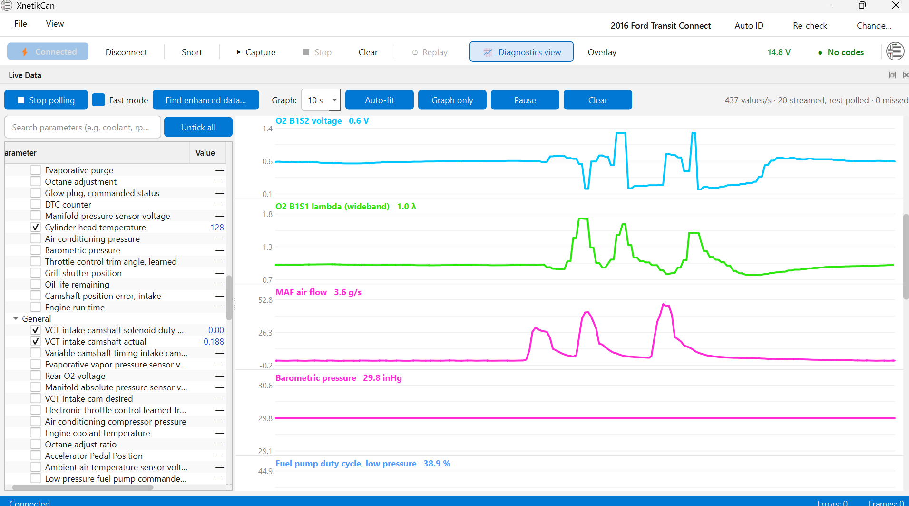
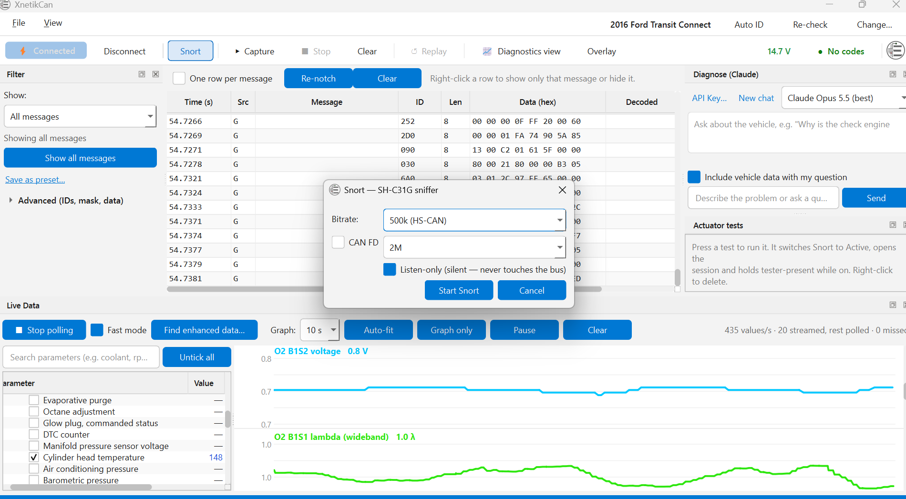
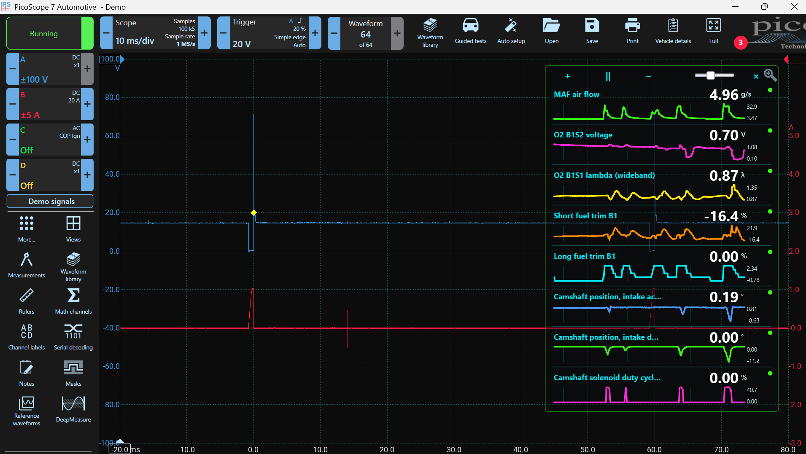

# XnetikCan

A Windows CAN / OBD-II Automotive diagnostic tool

C++17, Qt 6, CMake, MinGW 64-bit. Windows only.

## Status: work in progress

****This is under active development. 

- Not every feature has been tested on every vehicle.
- CAN FD and the bidirectional "actuator test" buttons are not yet working.
- Some screens are still being refined.
- Windows only.

## Screenshots

Live Data with the adapter picker: choose your J2534 device (Autel, Bosch VCM, Topdon, and others).

All-module scan: every module that answered, its trouble codes in plain English, and how many live values each one offers.

Live graphs: fast streaming parameters, scan-tool style, in your chosen units.

"Snort" raw-CAN sniffer (SH-C31G): the frame table with the notch filter, an optional AI diagnose panel, and saved actuator-test buttons.

The always-on-top overlay floats your chosen PIDs over PicoScope while you scope a circuit.

## Features

### Diagnostics (through a J2534 pass-thru adapter)

- Standard OBD-II: live data (Mode 01), freeze frame (Mode 02), trouble codes (stored, pending, permanent), readiness monitors, Mode 06 monitor tests in plain language, VIN and calibration IDs (Mode 09).
- Manufacturer-enhanced live data .
- All-module scan: finds modules, * cant correctly name or ID yet
- Fast mode: asks the engine computer to stream the values it can (much faster updates); anything it can't stream is polled.
- Works with common J2534 drivers

### Display

- Live PID graphing.
- Units Imperial and Metric 
- An always-on-top overlay that floats the PIDs you pick over PicoScope or anyting
- Optional Diagnose panel that can send a snapshot of the current data to claude model using your own API key 

### Raw CAN ("Snort", using a DSD SH-C31G adapter)

The SH-C31G is an isolated CANable 2.0 (gs_usb/WinUSB, no driver install).

- Sniff the bus silently (listen-only) or join it (active) Selectable speeds including Ford/GM medium-speed CAN.
- Frame table grouped per message 
- Hide the current stream traffic, so only new or changed messages show 
- UDS / ISO-TP decoded in plain language 
- Frame composer: edit a message's bytes and send
- Capture to CSV and open a CSV 
- Captured and save bidirectional command add a named toggle button per module (for example a fuel-pump test). The app opens the session and holds tester-present while it runs. *** WORK IN PROGRESS

## Hardware

- A Windows PC.
- A J2534 pass-thru adapter for diagnostics.
- A DSD SH-C31G (isolated CANable 2.0) for raw-CAN sniffing and sending.

## Build from source

Needs Qt 6.11.1 (mingw_64, with the SerialBus module), MinGW 13.1, and CMake.

A  32 to 64 bit J2534 bridge (for 32-bit adapter DLLs) is built separately with 32-bit MinGW.

## Repo layout

- `variant-dbc-fast/` — the application source (C++/Qt/CMake).
- `library/` — bundled vehicle data: OBDb signalsets, DBC files, DTC descriptions.
- `tools/` — a standalone gs_usb/WinUSB probe for the SH-C31G.
- `docs/images/` — the screenshots above.

## Data sources / acknowledgements

- OBDb signalsets — github.com/OBDb — licensed CC BY-SA 4.0.
- opendbc — comma.ai — MIT license.
- python-OBD — used for the generic DTC descriptions.
- The SH-C31G runs candleLight / gs_usb firmware.

## License

No license chosen yet — treat as all rights reserved until one is added.
